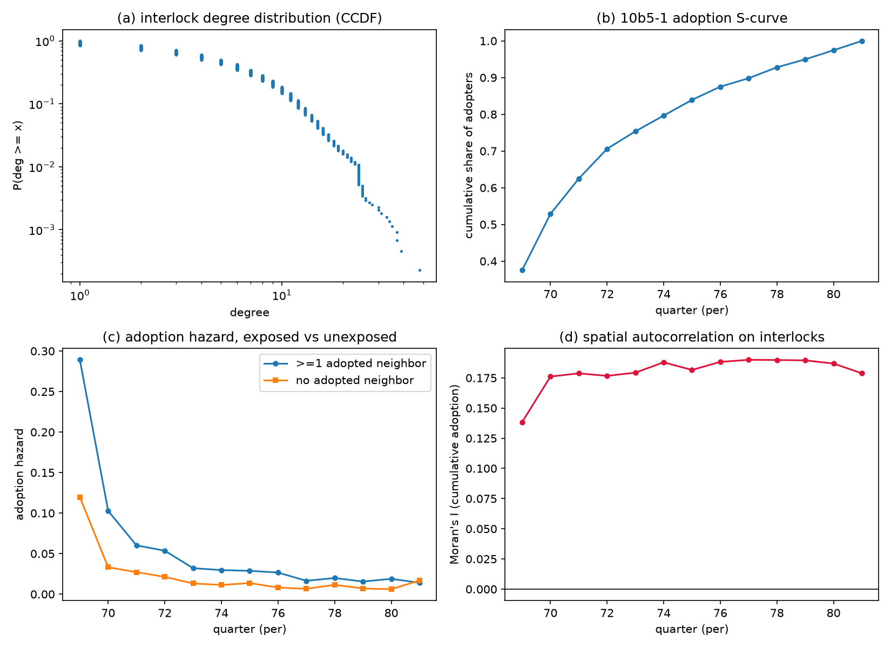
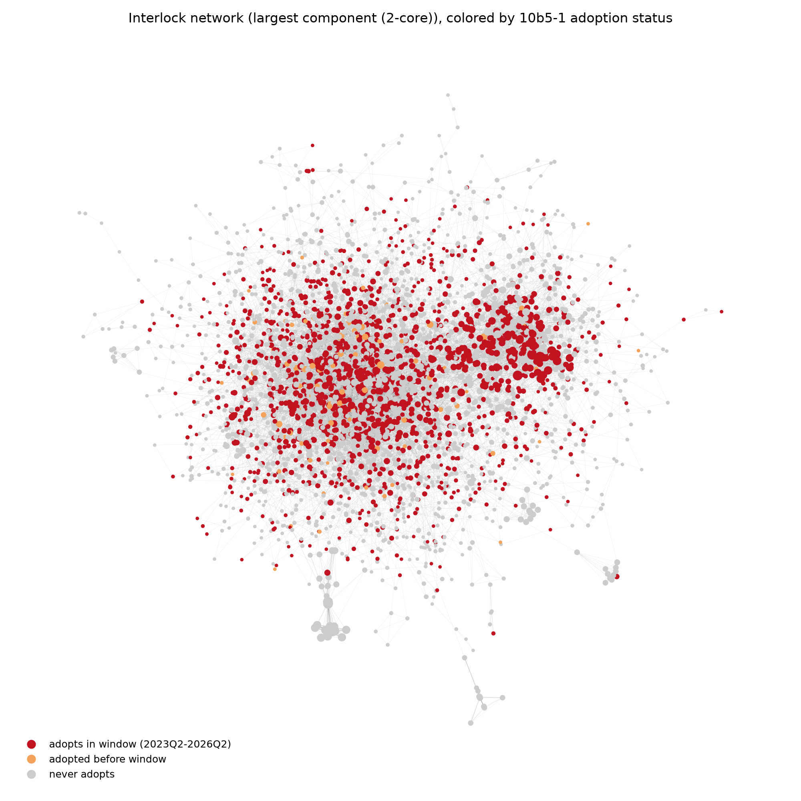
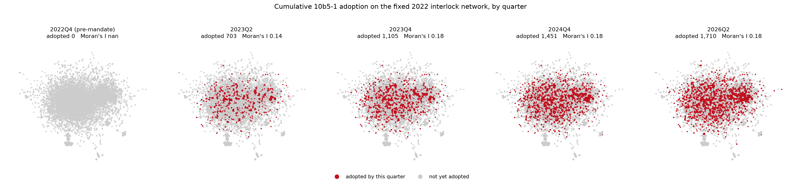

\noindent\textbf{Keywords:} Rule 10b5-1; insider trading; board interlocks; peer effects; homophily; network interference; randomization inference. JEL: G34, G38, G14, C21.. \vspace{1.5em}

## 1. Introduction

\[TO-FILL: motivation paragraph — the 2023 Rule 10b5-1 amendment as a discrete governance shock; why board interlocks are the natural diffusion channel for governance practices; the policy stakes of distinguishing influence from selection.\]

The central empirical difficulty is the **reflection problem:** firms connected by shared directors tend to be similar, so they may adopt a practice at the same time for reasons unrelated to the connection. Distinguishing contagion from homophily requires either an exogenous source of variation in neighbor adoption or a design that holds the selection channel fixed. This paper takes the design-based route.

Contributions. First, the paper provides a design-based decomposition of the observed interlock clustering of 10b5-1 adoption into a homophily component and a contagion residual, using randomization inference that permutes adoption timing within strata of interlock degree and pre-mandate trading activity. Second, it shows that the contagion residual is small and not robust, so the clustering is predominantly selection. Third, it documents why two widely used peer-effect estimators fail on this network and quantifies the direction and size of their bias.

\[TO-FILL: roadmap paragraph.\]

## 2. Related work

\[TO-FILL: Rule 10b5-1 history, the 2022 amendment, cooling-off requirement, effective dates — full prose.\] The Securities and Exchange Commission adopted the amendment in December 2022 (@securities2022insider); it took effect for most issuers on February 27, 2023, and imposes a mandatory cooling-off period between the adoption of a Rule 10b5-1 trading plan and the first trade under it (90 to 120 days for directors and officers \[verify day counts\]).

The paper draws on five literatures. First, a long line of work in organizational sociology and finance shows that corporate practices spread across the board-interlock network. @davis1991agents documents the diffusion of the poison pill through shared directors, @davis1997corporate extend this to other anti-takeover provisions, @haunschild1993interorganizational finds interlock-driven imitation in corporate acquisition activity, @bizjak2009option link the spread of option backdating to board connections, @bouwman2011corporate shows governance practices propagating through overlapping directors, and @fracassi2017corporate finds that director networks drive convergence in corporate financial policies. @mizruchi1996interlocks surveys what interlocks do. These studies establish interlocks as a plausible diffusion channel but largely measure association rather than isolate causal influence. Second, and central to this paper, a methodological literature shows that such association cannot by itself identify influence. @shalizi2011homophily prove that homophily and contagion are generically confounded in observational social-network data; @aral2009distinguishing decompose influence from homophily in an actual diffusion process; and @goldsmith2013social characterize when peer effects are identified once homophily is present. The decomposition in this paper is a response to this confounding. In a comment on @goldsmith2013social, @bramoulle2013comment frames joint link-and-outcome modeling as a network analog to Heckman selection correction, underscores how homophily links selection to outcome unobservables and complicates exclusion restrictions, and notes that heterogeneous peer effects do not generally reduce to a single uniform peer-effect parameter.

Third, the peer-effects literature formalizes why closing the gap is hard. @manski1993identification states the reflection problem: when peers are similar, endogenous influence cannot be separated from shared characteristics in the linear-in-means model (see also @manski2013identification). @bramoulle2009identification, @bramoulle2020peer show that peer effects can be identified on networks that are sufficiently sparse and intransitive, using the outcomes of friends-of-friends as instruments — a condition the interlock network violates (Section 5.1) — and @angrist2014perils catalogs the ways naive peer-effect estimators overstate influence. Fourth, the design-based literature on causal inference under interference supplies the estimators used here. Building on the potential-outcomes framework (@imbens2015causal) and randomization inference (@fisher1966design; @rosenbaum2002covariance), @hudgens2008toward define treatment and spillover estimands under partial interference; @aronow2017estimating develop exposure-mapping estimators and randomization inference for general interference; @savje2021average and @leung2020treatment extend estimation and inference to unknown and networked interference; @athey2018exact give exact tests of sharp nulls under network interference; @forastiere2021identification treat interference in observational network studies; and @eckles2017design show how interference biases naive estimators. Fifth, work on Rule 10b5-1 examines how insiders use trading plans: @jagolinzer2009sec shows that plan-based sales are strategically timed, and @cohen2012decoding distinguish routine from opportunistic insider trades, which informs the volume outcome in Section 6. The 2022 cooling-off amendment (@securities2022insider2) is the governance shock this paper exploits. \[TO-FILL: add a recent empirical study of the 2022 cooling-off amendment — do not cite from memory; verify first.\]

## 3. Method {#methodology-exposure-reconstruction}

### 3.1 Setup and notation

Let $V = \{1, \dots, n\}$ index the $n = 4{,}392$ networked firms. The board-interlock graph $G = (V, E)$ is fixed at its pre-treatment (2022) state and summarized by a symmetric adjacency matrix $A \in \{0,1\}^{n \times n}$, where $A_{ij} = 1$ if firms $i$ and $j$ share at least one director in 2022 and $A_{ij} = 0$ otherwise, with $A_{ii} = 0$. The graph has $m = 12{,}757$ edges. Firm $i$'s interlock degree is $d_i = \sum_{j} A_{ij}$, with mean $5.8$. Holding $A$ fixed at the pre-mandate year rules out reverse causation from adoption to network formation.

Time $t$ indexes calendar quarters through the index $\text{per} = 4(\text{year} - 2006) + (\text{quarter} - 1)$. The post-mandate window is $W = \{69, \dots, 81\}$ (2023Q2 through 2026Q2). Let $T_i \in \{0, 1, \dots\} \cup \{\infty\}$ be the quarter in which firm $i$ first discloses a Rule 10b5-1 cooling-off plan, with $T_i = \infty$ for firms that never adopt. Cumulative adoption is $Y_{it} = \mathbf{1}\{T_i \le t\}$, and the discrete-time adoption event is $a_{it} = \mathbf{1}\{T_i = t\}$, defined on the risk set $R_t = \{i : T_i \ge t\}$ of firms that have not yet adopted entering quarter $t$.

### 3.2 Exposure mapping and the co-adoption statistic

Following @aronow2017estimating, the effect of the rest of the network on firm $i$ is summarized by an exposure mapping that reduces the full adoption-state vector and the graph to a scalar neighborhood summary. The paper uses the binary neighbor-adoption exposure

$$ g_{it} = \mathbf{1}\!\left\{ \sum_{j} A_{ij}\, Y_{j,\,t-1} \ge 1 \right\}, $$

equal to one when at least one interlock neighbor of $i$ has already adopted by the end of quarter $t-1$. (Section 5.1 also uses the continuous neighbor-adopted fraction $f_{it} = d_i^{-1} \sum_j A_{ij} Y_{j,t-1}$.)

The target statistic is the pooled within-quarter association between own adoption and this exposure, holding the common mandate shock fixed through quarter fixed effects:

$$ a_{it} = \alpha_t + \beta\, g_{it} + \varepsilon_{it}, \qquad i \in R_t,\ t \in W. $$

By the Frisch–Waugh–Lovell theorem $\beta$ is the slope of quarter-demeaned adoption on quarter-demeaned exposure, $\hat\beta = \big(\sum_{i,t} \tilde a_{it}\,\tilde g_{it}\big) / \big(\sum_{i,t} \tilde g_{it}^{2}\big)$, where $\tilde{x}_{it} = x_{it} - \bar{x}_{t}$ removes the quarter mean. The observed value is $\hat\beta = +0.02978$. This statistic is not a causal peer effect: it conflates **contagion**, in which a neighbor's adoption raises $i$'s own hazard, with **homophily**, in which $i$ and its neighbors adopt together because they are similar firms facing a common shock. The two are generically confounded in observational network data (Shalizi and Thomas, 2011), and separating them is the reflection problem of @manski1993identification.

### 3.3 The homophily–contagion decomposition by randomization inference

Identification is design-based and rests on a sharp null rather than a parametric model. The sharp null of no contagion states that each firm's adoption timing $T_i$ does not depend on any neighbor's timing. Under this null, within a stratum of firms that are exchangeable on pre-treatment characteristics, the assignment of the realized adoption times to firms is uniformly distributed; any co-adoption that survives is produced by the fixed network acting on firms with common within-stratum propensities — that is, by homophily alone.

The paper partitions the in-window adopters into strata $S$ defined by the cross-classification of quartiles of pre-treatment degree $d_i$ and quartiles of pre-treatment insider-sale activity, at four granularities: $1\times 1$ (no stratification), $2\times 2$, $4\times 4$ (primary), and $8\times 8$. The randomization-inference procedure is:

1.  For each permutation $b = 1, \dots, B$ (with $B = 2000$), relabel the adoption times within each stratum — a uniform permutation of $\{T_i\}_{i \in s}$ for every stratum $s$ — holding the multiset of times per stratum fixed.
2.  Recompute the exposure $g_{it}^{(b)}$ from the fixed $A$ and the permuted timing, and the within-quarter slope $\beta^{(b)}$ from the regression in Section 4.2.
3.  Form the permutation null mean $\bar\beta_0 = B^{-1} \sum_b \beta^{(b)}$, the co-adoption slope generated by homophily alone, and the one-sided $p$-value $p = (1 + \#\{b : \beta^{(b)} \ge \hat\beta\}) / (B + 1)$.

The decomposition follows directly:

$$ \underbrace{\bar\beta_0 / \hat\beta}_{\text{homophily share}}, \qquad \underbrace{\hat\beta - \bar\beta_0}_{\text{contagion residual}}, \qquad \underbrace{(\hat\beta - \bar\beta_0)/\hat\beta}_{\text{contagion share}}. $$

As the strata refine, the null absorbs more homophily and $\bar\beta_0 \to \hat\beta$; at the limit of singleton strata the permutation has no freedom and the null equals the observed value by construction. The informative object is therefore the whole ladder of granularities, not any single cell: a contagion residual that shrinks monotonically as composition is controlled is evidence that the residual is itself residual homophily, not peer influence.

## 4. Data and network construction

**Insider filings.** The sample comprises Securities and Exchange Commission Form 345 filings (Forms 3, 4, and 5) for 2006Q1 through 2026Q3, parsed to the filing level and joined on the accession number. The plan indicator is the `AFF10B5ONE` field of the submission table, which is populated reliably from 2023Q2 onward; the 2023Q1 transition quarter is excluded because the field ramps in unevenly. A firm is coded as adopting in the first quarter in which any of its filings carries the plan flag. Treatment timing is the quarter of first adoption. The parsed panel holds 354,580 firm-quarter observations on 17,807 distinct firms; 4,392 of these firms are networked (defined below), and 1,612 of the networked firms first adopt a cooling-off plan within the 2023Q2–2026Q2 window.

**Interlock graph.** The board-interlock graph is fixed at its 2022 (pre-treatment) state: two firms are linked if at least one individual served as a director of both during 2022. This yields **4,392 networked firms and 12,757 edges, with mean degree 5.8**. Of these, **1,612 firms adopt within the 2023Q2–2026Q2 window, 98 adopted earlier, and 2,652 never adopt** in the window. Fixing the graph before treatment removes any feedback from adoption to network structure.

Table 1 reports summary statistics.

**Table 1. Summary statistics.**

*Panel A. Sample and interlock-graph structure.*

| Statistic                                       |   Value |
|-------------------------------------------------|--------:|
| Firm-quarter observations                       | 354,580 |
| Distinct firms                                  |  17,807 |
| Networked firms (nodes in 2022 interlock graph) |   4,392 |
| Interlock edges                                 |  12,757 |
| Mean degree                                     |     5.8 |
| Median degree                                   |       5 |
| Max degree                                      |      48 |
| Graph density                                   | 0.00132 |

*Panel B. Adoption status on the networked universe.*

| Group                           | Firms |  Share |
|---------------------------------|------:|-------:|
| Networked firms                 | 4,392 | 100.0% |
| Adopt in window (2023Q2–2026Q2) | 1,612 |  36.7% |
| Adopted before window           |    98 |   2.2% |
| Never adopt                     | 2,652 |  60.4% |

*Panel C. Firm characteristics by adoption status (degree = interlock degree; pre-activity = total insider sales 2021Q1–2022Q4).*

| Group | Degree mean | Degree median | Pre-activity mean | Pre-activity median | N |
|------------|-----------:|-----------:|-----------:|-----------:|-----------:|
| In-window adopters | 7.01 | 6 | 92.1 | 30 | 1,612 |
| Never-adopters | 5.04 | 4 | 24.6 | 3 | 2,652 |

*Panel D. Adoption counts by quarter (in-window adopters). Cumulative share of in-window adopters in the final column.*

| Quarter | Adopters | Cumulative | Cum. share |
|---------|---------:|-----------:|-----------:|
| 2023Q2  |      605 |        605 |      37.5% |
| 2023Q3  |      247 |        852 |      52.9% |
| 2023Q4  |      155 |      1,007 |      62.5% |
| 2024Q1  |      131 |      1,138 |      70.6% |
| 2024Q2  |       77 |      1,215 |      75.4% |
| 2024Q3  |       69 |      1,284 |      79.7% |
| 2024Q4  |       69 |      1,353 |      83.9% |
| 2025Q1  |       58 |      1,411 |      87.5% |
| 2025Q2  |       37 |      1,448 |      89.8% |
| 2025Q3  |       48 |      1,496 |      92.8% |
| 2025Q4  |       35 |      1,531 |      95.0% |
| 2026Q1  |       40 |      1,571 |      97.5% |
| 2026Q2  |       41 |      1,612 |     100.0% |

Two features of the raw data motivate the decomposition that follows. First, adoption is strongly clustered on the interlock network. The Moran's *I* (@moran1950notes) of cumulative adoption on the graph is between 0.14 and 0.19 in every quarter of the window, and a permutation join-count test rejects spatial randomness of adopter-adopter edges at every quarter (*z* ≈ 18–22, *p* ≈ 0.001). Second, adopting firms differ systematically from non-adopters on exactly the dimensions that drive interlock position and insider trading: in-window adopters have higher interlock degree (mean 7.0 versus 5.0) and far higher pre-mandate insider-sale activity (median 30 versus 3 sales; Panel C). Both selection and influence predict the observed clustering, which is the reflection problem in concrete form. A descriptive gap between exposed and unexposed firms is also present but front-loaded: in 2023Q2 the quarterly adoption hazard is 0.289 for firms with at least one already-adopting neighbor against 0.120 for firms with none, a gap of 0.17 that decays toward zero by 2026Q2. Figure 1 collects the degree distribution, the adoption S-curve, the exposed-versus-unexposed hazard path, and the Moran's *I* series. The front-loading at the mandate shock is consistent with common timing among similar firms rather than slow person-to-person transmission, but it cannot settle the question on its own; Section 4 does.

**Figure 1. Network descriptives.** (a) interlock degree distribution (complementary CDF, log-log); (b) cumulative share of in-window adopters by quarter; (c) quarterly adoption hazard for firms with at least one already-adopting neighbor versus none; (d) Moran's *I* of cumulative adoption on the interlock graph by quarter. \[Figure saved as `fig1_network_descriptives.png`.\]

**Figure 2. Interlock network, colored by adoption status.** Node-link drawing of the largest connected component of the 2022 interlock graph (3,983 firms, 90.7 percent of networked firms; 12,355 edges), laid out by a force-directed algorithm. Nodes are firms, sized by interlock degree and colored by whether the firm adopts a cooling-off plan within the 2023Q2–2026Q2 window, adopted before it, or never adopts. Adopters are visibly concentrated in the same regions of the network: the attribute assortativity of ever-adoption is +0.13, and adopter-adopter pairs account for 27.1 percent of edges against 18.1 percent under random mixing. The network is also strongly degree-assortative (+0.51), so high-degree firms connect to one another and form a dense core. This clustering is the phenomenon the paper explains, not evidence of contagion; Section 4 attributes most of it to homophily. \[Figure saved as `fig2_network_layout.png`.\]

**Figure 3. Cumulative adoption on the fixed 2022 interlock network, by quarter.** Small multiples on a single fixed force-directed layout of the largest component (2-core, for legibility); node positions are identical across panels, and only the color changes — crimson once a firm has adopted a cooling-off plan by the quarter shown, grey otherwise. Each panel reports the Moran's *I* of adoption on the full graph (comparable to Figure 1d). No firm has adopted in the pre-mandate panel (2022Q4); adoption then appears across the dense core at the mandate shock, with Moran's *I* = 0.14 already in the first post-mandate quarter (2023Q2), settling to 0.18 within two quarters and staying flat through 2026Q2. A contagion process spreading along interlocks would raise Moran's *I* steadily over the window as adoption propagated from firm to firm; the observed pattern instead shows adoption appearing near-simultaneously among similar, well-connected firms, which is the signature of a common shock and homophily, not transmission. \[Figure saved as `fig3_diffusion_trail.png`.\]

## 4. Homophily-versus-contagion decomposition

### 4.1 Design

Let the exposure of firm *i* in quarter *t* be an indicator that at least one interlock neighbor has already adopted by *t − 1*. The target statistic is the pooled within-quarter slope of own adoption on this exposure indicator, with quarter fixed effects (equivalently, a Frisch–Waugh–Lovell within-quarter regression). The observed slope is **+0.02978**.

Identification is design-based. Under the sharp null of no contagion, the timing of adoption is exchangeable within strata of firms that are similar on pre-treatment characteristics. The paper permutes adoption timing among in-window adopters within strata defined by quartiles of pre-treatment degree and pre-treatment trading activity, recomputes exposure and the slope for each of 2,000 permutations, and compares the observed slope with the permutation null. As the strata become finer, the null absorbs more homophily; the gap between the observed slope and the null mean is the contagion component net of the homophily captured by the strata.

### 4.2 Results

Table 2 reports the decomposition across a ladder of strata granularities.

**Table 2. Homophily-versus-contagion decomposition (randomization inference, B = 2000).**

| Strata (degree × activity) | Null mean | Residual | Homophily share | Contagion share | One-sided *p* |
|------------|------------|------------|------------|------------|------------|
| none (1×1) | 0.02613 | 0.00365 | 87.7% | 12.3% | 0.0005 |
| 2×2 | 0.02726 | 0.00252 | 91.5% | 8.5% | 0.014 |
| 4×4 (primary) | 0.02772 | 0.00206 | 93.1% | 6.9% | 0.028 |
| 8×8 | 0.02808 | 0.00170 | 94.3% | 5.7% | 0.053 |

*Observed slope = 0.02978. Homophily share = null mean / observed; contagion share = residual / observed.*

The contagion residual declines monotonically and loses conventional significance as homophily controls tighten, from 12.3 percent of the association (p = 0.0005) with no stratification to 5.7 percent (p = 0.053) under the finest stratification. The 4×4 specification is the primary one because its cells retain adequate sample size; there the decomposition is roughly 93 percent homophily and 7 percent contagion, with the residual marginally significant (p = 0.028).

Two readings are ruled out. The clustering is not purely contagion: even minimal homophily control attributes the overwhelming share of the association to selection. It is also not cleanly interpretable as a robust causal peer effect: the residual is sensitive to the strength of homophily controls. The honest statement is an upper bound — board-network contagion accounts for at most about one-eighth of the observed co-adoption, and plausibly far less once firm composition is held fixed.

\[Caveat to retain in the text: the drift toward 100 percent homophily at the finest strata is partly mechanical, because as strata approach singletons the permutation loses freedom and the null approaches the observed value by construction. The 8×8 p-value is therefore not evidence of exactly zero contagion; the informative object is the whole ladder, which shows the contagion estimate shrinking as composition is controlled.\]

## 5. Why naive peer-effect estimators overstate contagion

A reader might expect an instrumental-variables or fixed-effects estimator to recover a cleaner peer effect. On this network both fail, in known and diagnosable ways.

### 5.1 Friends-of-friends instrument is invalid on a dense, transitive graph

The two-stage specification instruments the neighbor-adopted fraction $f_{it}$ of Section 4.2 with the adopted fraction among two-hop-only neighbors, $z_{it} = \big(\sum_j B_{ij}\, Y_{j,t-1}\big) / \sum_j B_{ij}$, where $B_{ij} = \mathbf{1}\{(A^2)_{ij} > 0,\ A_{ij} = 0,\ i \ne j\}$ marks firms reachable in exactly two interlock steps but not directly connected. Identification in the sense of @bramoulle2009identification requires the exclusion restriction that two-hop neighbors affect firm $i$ only through its direct neighbors, which holds only if the graph is intransitive — if $(A^2)_{ij} > 0$ routinely fails to imply $A_{ij} = 1$. The global clustering coefficient measures exactly this closure,

$$ C = \frac{\operatorname{tr}(A^3)}{\sum_i d_i (d_i - 1)} = \frac{3 \times (\text{number of triangles})}{\text{number of connected triples}}, $$

and is compared against the Erdős–Rényi benchmark $C_{\text{ER}} = 2m / [n(n-1)]$ expected at the same edge density under random wiring.

The Bramoullé–Djebbari–Fortin instrument uses the adoption of two-hop-only neighbors to instrument direct-neighbor adoption, relying on network intransitivity for exclusion. On the interlock graph the first stage is strong — the two-hop adoption share enters with a coefficient of 0.398 (*t* = 15.1) — but the identifying assumption fails: the two-hop neighborhood is far larger than the one-hop neighborhood (mean two-hop-only degree is 37.3, against a one-hop mean of 5.8), so the two-hop adoption share is effectively a sector- or market-wide average with little firm-specific variation and an implausible exclusion restriction. The graph is also highly clustered, which is the direct symptom of the problem: the global clustering coefficient is 0.273 — about 207 times the Erdős–Rényi benchmark of 0.00132 at the same density — so edges are strongly concentrated in closed triads rather than spread at random. Strong triadic closure means two-hop neighbors sit in the same local environment and share the same latent characteristics as one-hop neighbors, so the two-hop adoption share carries the very homophily-driven variation it is meant to instrument away, and the exclusion restriction is not credible. The two-stage estimate is an uninformative null, not evidence against contagion: the instrumented neighbor-adoption coefficient is 0.003 (standard error 0.008, *p* = 0.71). For contrast, the reduced-form hazard of own adoption on the exposure indicator is positive and significant (0.0091, *p* \< 0.001, on a base quarterly hazard of 0.039), which is the same raw clustering the decomposition in Section 4 attributes almost entirely to homophily. The graph is also highly clustered, which is the direct symptom of the problem: the global clustering coefficient is 0.273 — about 207 times the Erdős–Rényi benchmark of 0.00132 at the same density — so edges are strongly concentrated in closed triads rather than spread at random. Strong triadic closure means two-hop neighbors sit in the same local environment and share the same latent characteristics as one-hop neighbors, so the two-hop adoption share carries the very homophily-driven variation it is meant to instrument away, and the exclusion restriction is not credible. The two-stage estimate is an uninformative null, not evidence against contagion: the instrumented neighbor-adoption coefficient is 0.003 (standard error 0.008, *p* = 0.71). For contrast, the reduced-form hazard of own adoption on the exposure indicator is positive and significant (0.0091, *p* \< 0.001, on a base quarterly hazard of 0.039), which is the same raw clustering the decomposition in Section 4 attributes almost entirely to homophily.

### 5.2 Within-director fixed-effects hazard is mechanically biased by immortal time

Let $\mathcal{K}$ index directors, and let a firm–director–quarter cell $(i, k, t)$ exist whenever director $k$ sits on the board of firm $i$ and $i$ is still at risk in quarter $t$. The within-director hazard is

$$ a_{ikt} = \lambda_k + \alpha_t + \beta\, g^{(k)}_{it} + \varepsilon_{ikt}, \qquad g^{(k)}_{it} = \mathbf{1}\{\text{another board of director } k \text{ has adopted by } t-1\}, $$

where $\lambda_k$ is a director fixed effect meant to absorb the transmitting director's own propensity to carry the practice and $\alpha_t$ is a quarter fixed effect. A within-director design asks whether a director's board adopts soon after that director's other board adopts, with $\lambda_k$ holding the director fixed. Estimated as a discrete-time hazard, this design returns a large negative coefficient on neighbor exposure (**−0.181**). The sign and size are a mechanical artifact, not a (reverse) peer effect. Exposure $g^{(k)}_{it}$ is an absorbing state, so slow adopters accumulate many exposed-but-not-adopting risk quarters that dilute the exposed hazard, while fast adopters leave the risk set while still unexposed; the director fixed effect then isolates exactly this within-cluster survivorship pattern.

A permutation placebo confirms the mechanism. Randomizing adoption timing among adopters — so that no contagion can exist by construction — leaves the estimator essentially unchanged: the placebo null has **mean −0.1705 (sd 0.003, range \[−0.176, −0.162\]) over 50 permutations**, against an observed −0.181 (*z* = −3.5, meaning the observed coefficient is barely more negative than the mechanical floor). The estimator has a mechanical floor near −0.17 regardless of the data-generating process and is therefore uninterpretable as a peer effect.

\[Table 3 — placebo distribution; figure with observed marker over the null histogram. TO-FILL figure.\]

## 6. Secondary result: no volume spillover

A neighbor's adoption of a cooling-off plan does not change a firm's own insider-sale volume through the interlock. Let $W_i = \mathbf{1}\{T_i \le \text{CUT}\}$ be the adoption (treatment) indicator by the end of the window and $\pi_i = \Pr(W_i = 1)$ its propensity, estimated nonparametrically within $4\times 4$ strata of pre-treatment degree and trading activity. For an untreated firm ($W_i = 0$) the two exposure cells are $c_{01}$ (at least one treated neighbor) and $c_{00}$ (no treated neighbor). Under an independent-Bernoulli design the analytic probability of each cell is

$$ \pi_i^{01} = (1 - \pi_i)\Big(1 - \!\!\prod_{j:\,A_{ij}=1}\!\!(1 - \pi_j)\Big), \qquad \pi_i^{00} = (1 - \pi_i)\!\!\prod_{j:\,A_{ij}=1}\!\!(1 - \pi_j). $$

The Hájek estimator of the mean outcome $Y_i$ (asinh insider-sale volume averaged over 2025Q1–2026Q2) in exposure cell $c$ is the self-normalized inverse-probability-weighted average

$$ \hat\mu_c = \frac{\sum_i \big(\mathbf{1}\{e_i = c\}/\pi_i^{c}\big)\, Y_i}{\sum_i \mathbf{1}\{e_i = c\}/\pi_i^{c}}, \qquad \hat\tau = \hat\mu_{01} - \hat\mu_{00}, $$

with weights winsorized at the 99th percentile. Inference draws $W_i \sim \text{Bernoulli}(\pi_i)$ independently 5,000 times, recomputes $\hat\tau$ under each draw, and reports the two-sided Bernoulli randomization-inference $p$-value.

The paper estimates this contrast on the canonical 4,392-node graph, comparing untreated firms with at least one treated neighbor (cell c01, 1,317 firms) against untreated firms with no treated neighbor (cell c00, 731 firms). Propensity to adopt is estimated nonparametrically within 4×4 strata of pre-treatment degree and trading activity (mean 0.33, range 0.05–0.63).

The Hájek-weighted outcome is 4.322 in c01 and 3.299 in c00, a contrast of τ̂ = +1.02. This is not evidence of spillover. Under Bernoulli randomization inference (5,000 draws from the estimated propensities), the null distribution of the contrast is itself centered well above zero (mean +0.85, standard deviation 0.42), because exposure to a treated neighbor is mechanically increasing in degree and degree is correlated with insider-sale volume. The observed contrast sits inside this null, with a two-sided *p*-value of 0.35. The sharp null of no volume spillover is not rejected. \[TO-FILL: optionally cross-reference the deprecated event-study path (`models/event_study_volume.py`), whose cleaned Sun–Abraham estimate also collapses to a null once the contaminated 2023Q1 baseline is dropped.\]

## 7. Conclusion

Adoption of 10b5-1 cooling-off plans is strongly clustered on the board-interlock network, but the clustering is predominantly homophily. A design-based decomposition attributes 88 to 94 percent of the co-adoption association to selection among similar firms and leaves only a small, non-robust contagion residual. Standard peer-effect estimators overstate contagion on this network for structural reasons that the paper diagnoses. The findings bound board-network influence in a governance-practice setting and caution researchers against reading co-adoption on dense interlock networks as evidence of causal peer influence.

\[TO-FILL: policy implication paragraph; what credible identification of governance contagion would require — a shock to a single neighbor's adoption that is unrelated to the focal firm's characteristics.\]

------------------------------------------------------------------------

## Appendix A. Robustness

\[TO-FILL: alternative strata definitions; alternative exposure (fraction vs indicator); cloglog hazard vs linear probability; permutation of status as well as timing.\]

### A.x Degree distribution

The interlock degree distribution is right-skewed and heavy-tailed (Figure 1a), but the paper makes no scale-free claim. A Clauset–Shalizi–Newman discrete power-law fit to the degree sequence gives a scaling exponent α = 2.90 above a lower cutoff xmin = 6, covering 42.3 percent of nodes (Kolmogorov–Smirnov distance 0.11). Although α falls in the range often associated with scale-free networks, a likelihood-ratio comparison decisively rejects the power law in favor of a lognormal alternative (normalized log-likelihood ratio R = −10.1, p \< 0.001) and in favor of an exponential alternative (R = −11.7, p \< 0.001). The degree distribution is therefore best described as heavy-tailed and lognormal, not scale-free. The distributional form is not used anywhere in the identification argument; the structural feature that matters for Section 5.1 is the graph's high clustering (global clustering coefficient 0.273, against an Erdős–Rényi benchmark of 0.00132), not the tail exponent.

## Appendix B. Data construction

\[TO-FILL: parser details; `AFF10B5ONE` cleaning; 2023Q1 exclusion; interlock projection from the director–firm bipartite graph.\]

## Data and code availability

## Declarations

Funding:

Competing interests:

Author contributions:

Use of AI tools in preparation:

## Appendix — Variables

## References {.unnumbered}

::: {#refs}
:::